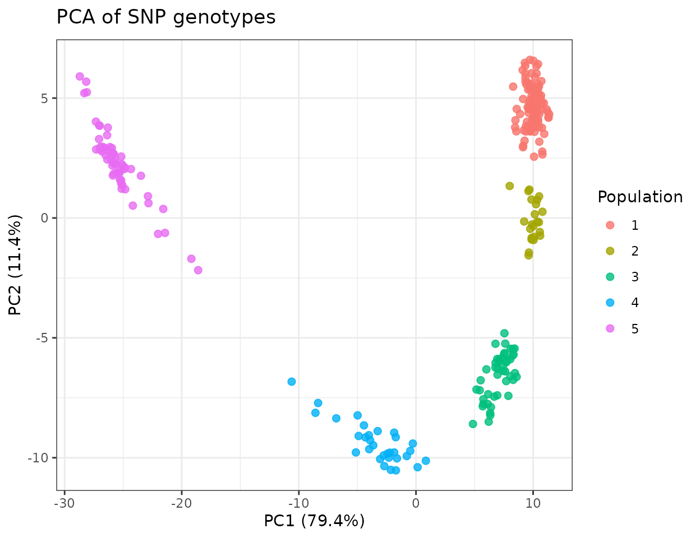
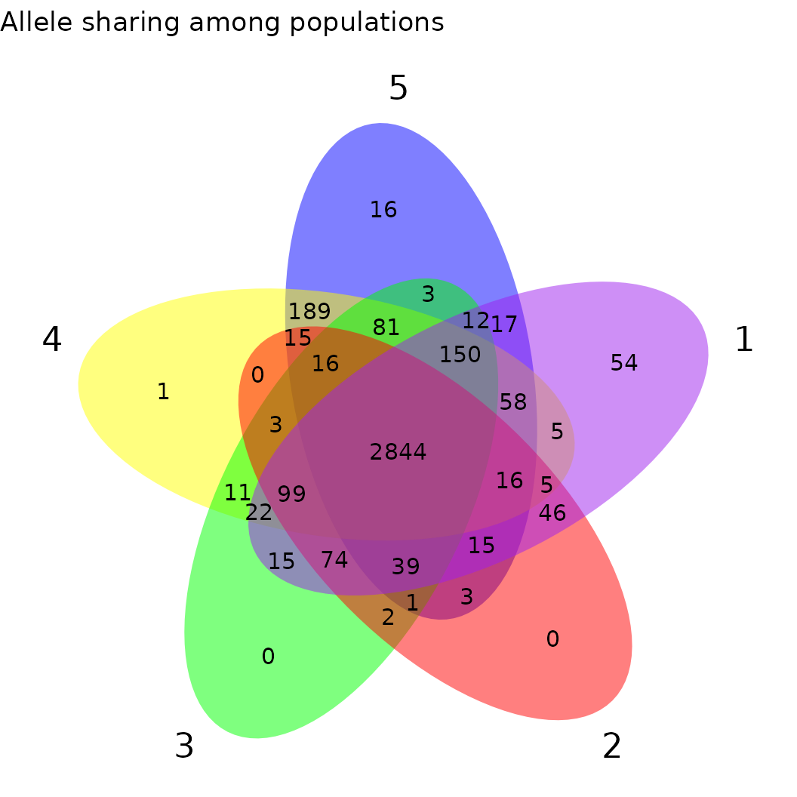
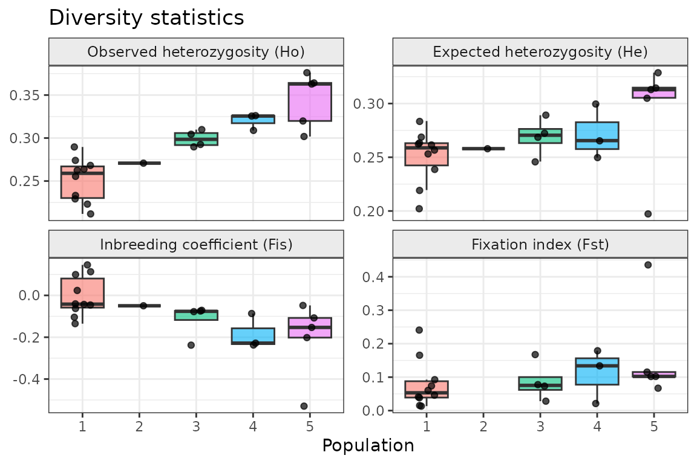
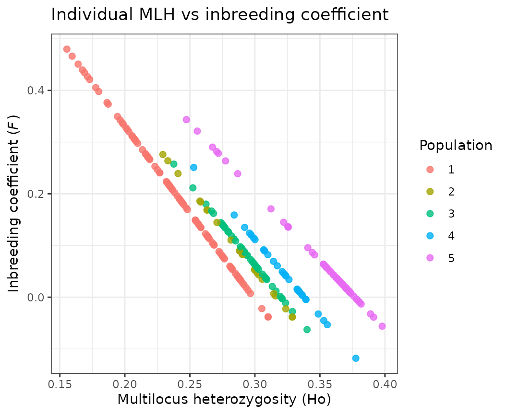
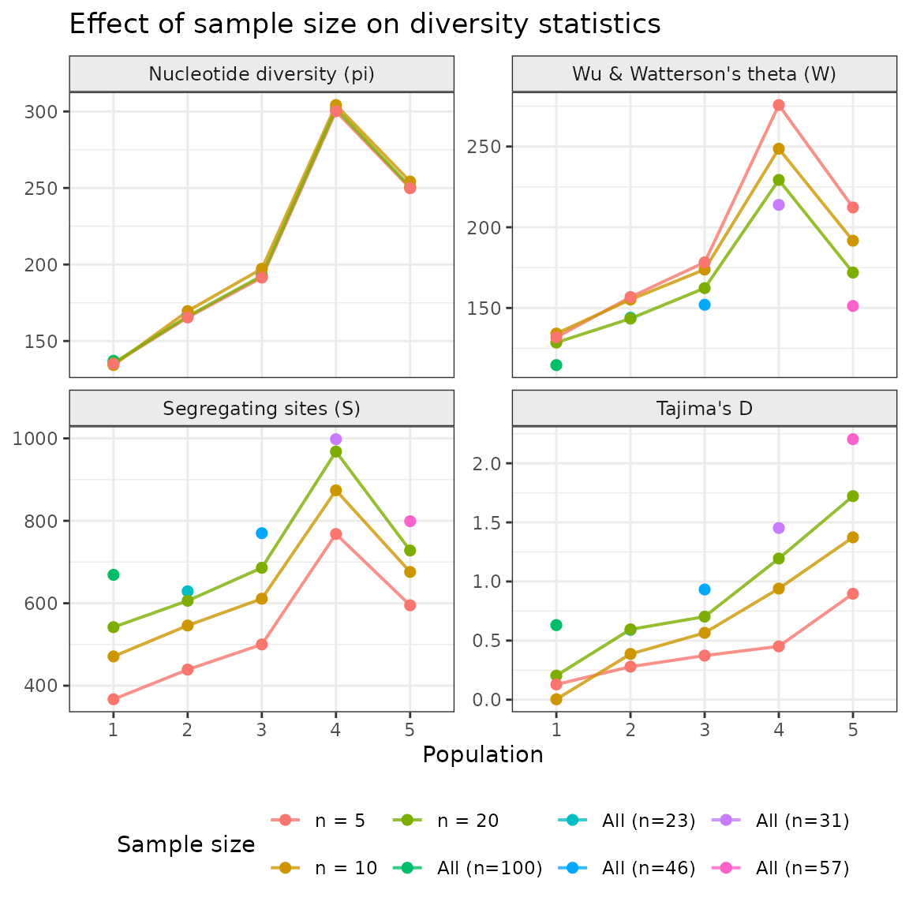

# Introduction to fastDiversity

## Overview

`fastDiversity` provides fast and flexible calculation of standard
population genetic diversity statistics from biallelic SNP data. It is
designed for datasets where samples span multiple populations, sites, or
species that need to be analysed simultaneously, a common scenario in
conservation genomics and comparative population studies.

The package accepts genotype data in standard biallelic dosage format:
`0` (homozygous reference, *aa*), `1` (heterozygous, *aA*), and `2`
(homozygous alternate, *AA*), with missing data as `NA`. This format is
the output produced by most SNP-calling pipelines.

------------------------------------------------------------------------

## Installation

``` r

remotes::install_github("eilishmcmaster/fastDiversity")
```

``` r

library(fastDiversity)
library(dplyr)
library(ggplot2)
library(ggthemes)
```

------------------------------------------------------------------------

## Example dataset

The package ships with unpublished DArTseq SNP data from a plant species
from eastern Australia (see
[`?example_data`](https://eilishmcmaster.github.io/fastDiversity/reference/example_data.md)).
The dataset spans five genetic populations, each sampled across multiple
sites. This structure, multiple hierarchical grouping levels within a
single species, is the typical use case for `fastDiversity`.

``` r

data(example_data)

# Genotype matrix: rows are samples, columns are SNP loci
# Values are 0 (aa), 1 (aA), 2 (AA), or NA (missing)
dim(example_gt)
#> [1]  257 1906

example_print <- example_gt[c(1,100,150,200,250), 1:10]
colnames(example_print) <- NULL
example_print
#>                               
#> NSW1008199 0 2 0 2 0 0 1 1 1 1
#> NSW1015673 0 1 1 2 2 0 2 1 1 0
#> NSW1014534 2 0 1 1 2 1 0 0 1 0
#> NSW1088929 2 0 2 1 2 1 1 0 0 1
#> NSW1146190 2 0 1 1 2 1 0 1 0 0
```

``` r

# Metadata: one row per sample, matching the row order of example_gt
head(example_meta)
#>       sample         site population
#> 1 NSW1008199 Wambam_Creek          5
#> 2 NSW1008169 Wambam_Creek          5
#> 3 NSW1008189 Wambam_Creek          5
#> 4 NSW1008229 Wambam_Creek          5
#> 5 NSW1008224 Wambam_Creek          5
#> 6 NSW1009574 Wambam_Creek          5

# Five genetic populations, each with multiple sampling sites
table(example_meta$site, example_meta$population)
#>                           
#>                             1  2  3  4  5
#>   Airdrop_Rd                6  0  0  0  0
#>   Best_of_All_Lookout       5  0  0  0  0
#>   Big_Nellie                0  0  5  0  0
#>   Big_Scrub Loop1           6  0  0  0  0
#>   Big_Scrub Loop2           6  0  0  0  0
#>   Binna_Burra               6  0  0  0  0
#>   Blackbutt                 4  0  0  0  0
#>   Bo_Bo_River               0  6  0  0  0
#>   Boorganna                 0  0  6  0  0
#>   Broughton                 0  0  0  0  5
#>   Cambewarra                0  0  0  0  5
#>   Clyde_Mountain            0  0  0  0  4
#>   Conjola                   0  0  0  0  7
#>   Coombahjah                0  5  0  0  0
#>   Dingo_Tops                0  0  6  0  0
#>   Dorrigo_NP                0  5  0  0  0
#>   Fitzroy_Falls             0  0  0  0  6
#>   Gibbergunyah Nightcap Tk 11  0  0  0  0
#>   Glen_NR                   0  0  3  0  0
#>   Gloucester_Tops           0  0  6  0  0
#>   Jerusalem_Tk              0  0  5  0  0
#>   Junuy_Jurum_NP            0  1  0  0  0
#>   Katandra_NR               0  0  0  4  0
#>   Killen_Falls              1  0  0  0  0
#>   Knodingbull               0  0  6  0  0
#>   Koonyum_Range             6  0  0  0  0
#>   Lamington_NP              6  0  0  0  0
#>   Macquarie_Pass            0  0  0  0  4
#>   Mary_Cairncross           6  0  0  0  0
#>   Minnamurra                0  0  0  0  1
#>   Mt_Jerusalem              5  0  0  0  0
#>   Mt_Keira                  0  0  0  0  3
#>   Mt_Nardi                 11  0  0  0  0
#>   Mt_Nothofagus             5  0  0  0  0
#>   Mt_Tomah                  0  0  0  4  0
#>   Murramurang_NP            0  0  0  0  6
#>   Old_Mill_Rd               3  0  0  0  0
#>   Olney_SF                  0  0  0  6  0
#>   Oxley_Hwy                 0  0  2  0  0
#>   Palm_Grove                0  0  0  6  0
#>   Pine_Creek_SF             0  2  0  0  0
#>   Rolland_Plains            0  0  3  0  0
#>   Royal_NP                  0  0  0  0  2
#>   Rummery_Road              6  0  0  0  0
#>   Strickland_SF             0  0  0  6  0
#>   Terania_Creek             5  0  0  0  0
#>   Tungun Rd Rocky Ck        2  0  0  0  0
#>   Wambam_Creek              0  0  0  0  6
#>   Wandean_Gap               0  0  0  0  2
#>   Wang_Wauk_SF              0  0  0  2  0
#>   Washpool                  0  4  0  0  0
#>   Wauchope                  0  0  1  0  0
#>   Werrikimbe_NP             0  0  3  0  0
#>   Wodi_Wodi_Tk              0  0  0  0  6
#>   Wollemi_NP                0  0  0  3  0
```

The row order of `example_gt` must match the row order of
`example_meta`, the nth row of the genotype matrix corresponds to the
nth row of the metadata.

------------------------------------------------------------------------

## Principal coordinates analysis

A distance-based PCA provides an intuitive overview of genetic structure
across individuals. PC scores are computed from pairwise genetic
distances and merged with metadata for plotting:

``` r

pca   <- prcomp(dist(example_gt), center = TRUE, scale. = TRUE)
s_pca <- summary(pca)

# Axis labels showing % variance explained
importance <- s_pca[["importance"]][2, ]
axis_names  <- paste0(names(importance), " (", round(importance * 100, 1), "%)")

# Merge PC scores with sample metadata
pcs <- pca$x %>%
  data.frame() %>%
  merge(example_meta, by.x = 0, by.y = "sample")

ggplot(pcs, aes(x = PC1, y = PC2, color = factor(population))) +
  geom_point(size = 2, alpha = 0.8) +
  labs(
    title  = expression("PCA of SNP genotypes"),
    x      = axis_names[1],
    y      = axis_names[2],
    color  = "Population"
  ) +
  theme_bw()
```



Clustering of samples in PCA space corroborates the population structure
indicated by the diversity statistics and private allele analysis.

------------------------------------------------------------------------

## Allele sharing and private alleles

Understanding which alleles are unique to a single population (private)
versus shared across populations is a useful first step in assessing
population distinctiveness. Populations with many private alleles may
represent distinct evolutionary lineages that warrant separate
management.

### Step 1: Build the allele list

[`make_allele_list()`](https://eilishmcmaster.github.io/fastDiversity/reference/make_allele_list.md)
takes the genotype matrix and a grouping vector and returns a named list
of allele sets, one per group.

``` r

allele_list_population <- make_allele_list(example_gt, example_meta$population)
#> There are 57 samples in 5
#> There are 31 samples in 4
#> There are 46 samples in 3
#> There are 23 samples in 2
#> There are 100 samples in 1

names(allele_list_population)
#> [1] "5" "4" "3" "2" "1"
```

### Step 2: Visualise allele overlap

Because the result is a standard named list, it works directly with
`ggvenn`:

``` r

ggvenn::ggvenn(allele_list_population, 
               stroke_size=0)+
  ggtitle("Allele sharing among populations")
```



Alternatively, an upset plot may be easier to read:

``` r

ggVennDiagram::plot_upset(ggVennDiagram::Venn(allele_list_population), sets.bar.show.numbers = FALSE)
```


This shows how much allelic diversity is shared across populations
versus restricted to individual groups. A large exclusive region
indicates a genetically distinct population.

### Step 3: Count private and total alleles

``` r

private_total_alleles_population <- calculate_private_alleles(allele_list_population)

private_total_alleles_population
#>   population private_allele_count total_allele_count
#> 1          5                   24               3425
#> 2          4                    1               3474
#> 3          3                    0               3245
#> 4          2                    0               2966
#> 5          1                   58               3334
#> 6      Total                 3812               3812
```

The output gives private allele counts (alleles found in only one
population) and total allele counts per group. These can be used
directly in reporting or joined to the main statistics table (shown
below).

------------------------------------------------------------------------

## Diversity statistics with `faststats()`

[`faststats()`](https://eilishmcmaster.github.io/fastDiversity/reference/faststats.md)
calculates allelic richness, heterozygosity, inbreeding coefficients,
and population differentiation for each combination of genetic group and
site, with locus-level filtering applied independently within each
genetic group.

### Filtering parameters

| Parameter | Description |
|----|----|
| `minimum_n` | Exclude sites with fewer than this many individuals |
| `minimum_loci` | Exclude genetic groups where fewer than this many loci pass filtering |
| `maf` | Minor allele frequency threshold: loci below this value are excluded per genetic group (typically 0.05) |
| `max_missingness` | Exclude loci missing in more than this proportion of samples within a group (e.g. 0.3 removes loci missing in \>30% of samples) |

Filtering is applied within each genetic group independently. A locus
retained for one population may be excluded for another if it fails MAF
or missingness thresholds in that group, an important distinction from
global pre-filtering, which can retain uninformative loci in some groups
or discard informative ones in others.

### Running faststats

`genetic_group_variable` defines the level at which locus filtering is
applied (e.g. species or population). `site_variable` defines the
grouping unit for which statistics are calculated (e.g. sampling site).
The function returns one row per unique genetic group × site
combination.

``` r

basicstats <- faststats(
  gt                    = example_gt,
  genetic_group_variable = example_meta$population,
  site_variable         = example_meta$site,
  minimum_n             = 6,
  minimum_loci          = 50,
  maf                   = 0.05,
  max_missingness       = 0.3
)
#> 1 complete
#> 2 complete
#> 3 complete
#> 4 complete
#> 5 complete
#> Process complete!

head(basicstats)
#> # A tibble: 6 × 12
#>   group site      Ar    Ho    He   uHe     Fis    Gst    Fst    uFis  loci     n
#>   <chr> <chr>  <dbl> <dbl> <dbl> <dbl>   <dbl>  <dbl>  <dbl>   <dbl> <dbl> <dbl>
#> 1 1     Airdr…  1.68 0.268 0.256 0.283 -0.046  0.142  0.046   0.0527   844     6
#> 2 1     Big_S…  1.70 0.290 0.262 0.289 -0.104  0.122  0.0407 -0.0013   844     6
#> 3 1     Big_S…  1.72 0.262 0.269 0.297  0.0237 0.0999 0.0134  0.117    844     6
#> 4 1     Binna…  1.69 0.264 0.253 0.278 -0.0433 0.154  0.0604  0.0526   844     6
#> 5 1     Gibbe…  1.74 0.256 0.284 0.299  0.0997 0.0502 0.0153  0.145    844    11
#> 6 1     Koony…  1.59 0.233 0.220 0.244 -0.0626 0.265  0.166   0.0441   844     6
```

### Output columns explained

| Column | Description |
|----|----|
| `group` | Genetic group ID (e.g. population, species) |
| `site` | Site ID |
| `Ar` | Rarefied allelic richness: expected number of alleles per locus at the smallest sample size among sites in the group (Kalinowski 2004) |
| `Ho` | Observed heterozygosity: proportion of heterozygous loci averaged across individuals |
| `He` | Expected heterozygosity under Hardy-Weinberg equilibrium within site_variable |
| `uHe` | Unbiased expected heterozygosity (corrected for small sample size) |
| `Fis` | Inbreeding coefficient (1 - Ho/He). Positive values indicate excess homozygosity; negative values indicate excess heterozygosity |
| `uFis` | Unbiased inbreeding coefficient (1 - Ho/uHe) |
| `Gst` | Gene diversity differentiation (Nei 1973) for the site: (Ht - Hs) / Ht, where Hs is the site’s He and Ht the He of the whole genetic group |
| `Fst` | Population-specific FST (Weir & Goudet 2017) for the site, relative to the other sites in the group; the per-population counterpart of Weir & Cockerham’s (1984) θ |
| `loci` | Number of loci retained after filtering for this group |
| `n` | Number of individuals sampled at this site x group combination |

### Plotting diversity statistics

Because
[`faststats()`](https://eilishmcmaster.github.io/fastDiversity/reference/faststats.md)
returns one row per site, each population contributes multiple points,
one per site. A faceted multi-panel plot gives a simultaneous overview
of heterozygosity, inbreeding, and differentiation:

``` r

library(tidyr)

stats_long <- basicstats %>%
  mutate(across(c(Ho, He, Fis, Fst), as.numeric)) %>%
  pivot_longer(
    cols      = c(Ho, He, Fis, Fst),
    names_to  = "statistic",
    values_to = "value"
  ) %>%
  mutate(statistic = factor(statistic,
    levels = c("Ho", "He", "Fis", "Fst"),
    labels = c("Observed heterozygosity (Ho)",
               "Expected heterozygosity (He)",
               "Inbreeding coefficient (Fis)",
               "Fixation index (Fst)")
  ))

ggplot(stats_long, aes(x = group, y = value, fill = group)) +
  geom_boxplot(alpha = 0.6, outlier.shape = NA) +
  geom_jitter(width = 0.15, size = 1.5, alpha = 0.7) +
  facet_wrap(~ statistic, scales = "free_y", ncol = 2) +
  labs(
    title = "Diversity statistics",
    x     = "Population",
    y     = NULL
  ) +
  theme_bw() +
  theme(
    legend.position  = "none",
    strip.background = element_rect(fill = "grey92"),
    strip.text       = element_text(size = 9)
  )
```



### Optional: bootstrapped confidence intervals

For published reporting, bootstrapped confidence intervals can be added
around Ho, He, and Fis. Two resampling strategies are available:

- **By loci** (`get_CI_loci_resampling = TRUE`): analogous to
  [`hierfstat::boot.ppfis`](https://rdrr.io/pkg/hierfstat/man/boot.ppfis.html)
  : loci are resampled with replacement to quantify how sensitive
  statistics are to the choice of markers.
- **By individuals** (`get_CI_individual_resampling = TRUE`): analogous
  to `diveRsity::basicstats` : individuals are resampled with
  replacement to quantify sampling uncertainty.

``` r

basicstats_ci <- faststats(
  gt                     = example_gt,
  genetic_group_variable = example_meta$population,
  site_variable          = example_meta$site,
  minimum_n              = 6,
  minimum_loci           = 50,
  maf                    = 0.05,
  max_missingness        = 0.3,
  get_CI_loci_resampling = TRUE,
  boots                  = 100,
  CI_alpha               = 0.05
)
```

CI columns are appended with a prefix for the resampling strategy
(`loci_` or `ind_`) and a suffix for the statistic and quantile boundary
(e.g. `loci_ho.2.5%`, `loci_ho.97.5%`). These plug directly into
[`geom_pointrange()`](https://ggplot2.tidyverse.org/reference/geom_linerange.html):

``` r

ggplot(basicstats_ci, aes(x = group, y = as.numeric(Ho), colour = group)) +
  geom_pointrange(
    aes(
      ymin = as.numeric(`loci_ho.2.5%`),
      ymax = as.numeric(`loci_ho.97.5%`)
    ),
    position = position_jitter(width = 0.2, seed = 1),
    size = 0.6
  ) +
  labs(
    title = expression("Ho ± 95% CI (loci bootstrap)"),
    x = "Population",
    y = "Observed heterozygosity (Ho)"
  ) +
  theme_bw() +
  theme(legend.position = "none")
```

### Optional: Hardy-Weinberg equilibrium testing

[`faststats()`](https://eilishmcmaster.github.io/fastDiversity/reference/faststats.md)
can test whether allele frequencies at each site deviate significantly
from Hardy-Weinberg equilibrium expectations using Fisher’s exact test,
with p-values combined across loci using Fisher’s method:

``` r

basicstats_hwe <- suppressWarnings( faststats(
  gt                     = example_gt,
  genetic_group_variable = example_meta$population,
  site_variable          = example_meta$population,
  minimum_n              = 6,
  minimum_loci           = 50,
  maf                    = 0.05,
  max_missingness        = 0.3,
  run_HWE_test           = TRUE,
  return_locus_stats     = FALSE   # set TRUE to retrieve per-locus p-values
))

basicstats_hwe[,c("site", "Ho", "He", "Fis", "Fst", "loci", "n", "HWE_p")]
```

The `HW_fisher_p` column gives the combined p-value per site. Sites with
values below the chosen alpha threshold show significant deviation from
HWE, which may reflect inbreeding, cryptic population structure within a
site, selection at linked loci, or genotyping artefacts.

------------------------------------------------------------------------

## Individual-level statistics

In addition to site-level summaries, `fastDiversity` provides two
functions for calculating statistics at the level of individual samples.
These are useful for examining variation in inbreeding and
heterozygosity on an individual basis, which can be informative for
fitness and hybridisation.

Both functions apply the same locus-level filtering as
[`faststats()`](https://eilishmcmaster.github.io/fastDiversity/reference/faststats.md):
MAF and missingness thresholds are applied per genetic group before
calculation, ensuring that individual estimates are based on the same
high-quality, informative loci used in population-level analyses.

### Individual multilocus heterozygosity

[`individual_Ho()`](https://eilishmcmaster.github.io/fastDiversity/reference/individual_Ho.md)
calculates multilocus heterozygosity (MLH) for each sample: the
proportion of retained loci that are heterozygous in that individual.

``` r

ind_MLH_ho <- individual_Ho(
  example_gt,
  genetic_group_variable = example_meta$population,
  maf                    = 0.05,
  max_missingness        = 0.3
)

head(ind_MLH_ho)
#> NSW1008199 NSW1008169 NSW1008189 NSW1008229 NSW1008224 NSW1009574 
#>  0.3719705  0.2673913  0.2556880  0.2719298  0.2706522  0.3679834
```

### Individual inbreeding coefficient (Wright’s *F*)

[`individual_F()`](https://eilishmcmaster.github.io/fastDiversity/reference/individual_F.md)
calculates Wright’s inbreeding coefficient for each sample: *F* = 1 −
(Ho / He), where He is calculated across the genetic group. This
measures the probability that both alleles at a locus are identical by
descent (Frankham, Ballou & Briscoe 2010). Because He is calculated at
the group level rather than across genetic groups, estimates are not
deflated by the Wahlund effect that would arise from pooling genetically
differentiated individuals.

``` r

ind_F <- individual_F(
  example_gt,
  genetic_group_variable = example_meta$population,
  maf                    = 0.05,
  max_missingness        = 0.3
)

head(ind_F)
#> NSW1008199 NSW1008169 NSW1008189 NSW1008229 NSW1008224 NSW1009574 
#> 0.01264873 0.29024170 0.32130680 0.27819474 0.28158612 0.02323208
```

### Relating MLH to *F*

Plotting individual MLH against *F* reveals the expected negative
relationship: individuals with higher observed heterozygosity have lower
inbreeding coefficients.

``` r

# Combine into a data frame and add population labels
ind_df <- data.frame(
  sample     = names(ind_MLH_ho),
  MLH        = as.numeric(ind_MLH_ho),
  F          = as.numeric(ind_F)
) %>%
  merge(example_meta, by = "sample")

ggplot(ind_df, aes(x = MLH, y = F, colour = as.factor(population))) +
  geom_point(size = 2, alpha = 0.8) +
  labs(
    title    = expression("Individual MLH vs inbreeding coefficient"),
    x        = "Multilocus heterozygosity (Ho)",
    y        = expression(paste("Inbreeding coefficient (", italic(F), ")")),
    colour   = "Population"
  ) +
  theme_bw()
```



## Nucleotide diversity and Tajima’s D

[`pi_theta_d_stats()`](https://eilishmcmaster.github.io/fastDiversity/reference/pi_theta_d_stats.md)
calculates nucleotide diversity (pi), Wu & Watterson’s theta (W), the
number of segregating sites (S), and Tajima’s D for each genetic
site_variable specified within genetic_group_variable. The
implementation follows the missing-data-aware approach of Korunes &
Samuk (2021), meaning that loci with missing genotypes contribute
proportionally rather than being excluded entirely, an important
correction for RADseq and DArTseq data where missingness is common.

### Running pi_theta_d_stats

When `n = NULL`, all individuals at each site are used. The `n` argument
can be set to a fixed integer to subsample individuals, which allows
comparison across sites with unequal sample sizes:

``` r

# Use all available individuals per population
D_n_all <- pi_theta_d_stats(
  example_gt,
  genetic_group_variable = example_meta$population,
  site_variable          = example_meta$population,
  n                      = NULL,
  minimum_n              = 5,
  minimum_loci           = 5,
  max_missingness        = 0.1,
  maf                    = 0,
  allele_count_min       = 0
)
#> Process complete!

# Subsample to 20 individuals per population
D_n_20 <- pi_theta_d_stats(
  example_gt,
  genetic_group_variable = example_meta$population,
  site_variable          = example_meta$population,
  n                      = 20,
  minimum_n              = 5,
  minimum_loci           = 5,
  max_missingness        = 0.1,
  maf                    = 0,
  allele_count_min       = 0
)
#> Process complete!

# Subsample to 10 individuals per population
D_n_10 <- pi_theta_d_stats(
  example_gt,
  genetic_group_variable = example_meta$population,
  site_variable          = example_meta$population,
  n                      = 10,
  minimum_n              = 5,
  minimum_loci           = 5,
  max_missingness        = 0.1,
  maf                    = 0,
  allele_count_min       = 0
)
#> Process complete!

# Subsample to 5 individuals per population
D_n_5 <- pi_theta_d_stats(
  example_gt,
  genetic_group_variable = example_meta$population,
  site_variable          = example_meta$population,
  n                      = 5,
  minimum_n              = 5,
  minimum_loci           = 5,
  max_missingness        = 0.1,
  maf                    = 0,
  allele_count_min       = 0
)
#> Process complete!
```

### Output columns explained

| Column | Description |
|----|----|
| `group` | Genetic group ID |
| `site` | Site ID |
| `loci` | Number of loci retained after filtering |
| `n` | Number of individuals used |
| `pi` | Nucleotide diversity: pairwise differences summed over segregating sites |
| `S` | Number of segregating (polymorphic) sites |
| `theta` | Wu & Watterson’s theta: diversity estimate based on S, corrected for sample size, summed over segregating sites |
| `D` | Tajima’s D: standardised difference between pi and W. Negative values suggest an excess of rare variants (population expansion or purifying selection); positive values suggest an excess of intermediate-frequency variants (balancing selection or population contraction) |
| `real_missingness` | Proportion of missing data in the filtered matrix used for calculation |

### Monomorphic sites

The example data, like most SNP-calling output, contains only
polymorphic sites.
[`pi_theta_d_stats()`](https://eilishmcmaster.github.io/fastDiversity/reference/pi_theta_d_stats.md)
excludes monomorphic sites, and `pi` and `theta` are sums over
segregating sites rather than per-site (per-nucleotide) values. Per-site
estimates would require the number of invariant sites sequenced, which
is not available for many reduced-representation datasets; monomorphic
SNP loci alone do not provide it. `pi` and `theta` therefore scale with
the number of loci analysed and are comparable among sites analysed with
the same loci. Tajima’s D does not depend on invariant sites.

The same applies to Ho, He, uHe and Ar from
[`faststats()`](https://eilishmcmaster.github.io/fastDiversity/reference/faststats.md),
which are averages over the loci analysed: they are comparable among
sites within a genetic group, but are not genome-wide heterozygosity.
Fis, Gst and Fst are ratios and do not depend on monomorphic sites.

### Effect of sample size on diversity estimates

A key feature of
[`pi_theta_d_stats()`](https://eilishmcmaster.github.io/fastDiversity/reference/pi_theta_d_stats.md)
is the `n` argument, which subsamples individuals to a fixed number
before calculation. This allows fair comparison across populations with
unequal sample sizes. However, sample size affects estimates
differently: S is particularly sensitive to n because larger samples are
more likely to capture rare variants, which inflates W relative to pi
and therefore pulls D negative.

The plot below illustrates this by comparing estimates across three
levels of subsampling:

``` r

library(tidyr)

# Combine results and label by sample size used
D_combined <- bind_rows(
  D_n_all %>% mutate(sample_size = paste0("All (n=", n, ")")),
  D_n_20  %>% mutate(sample_size = "n = 20"),
  D_n_10  %>% mutate(sample_size = "n = 10"),
  D_n_5   %>% mutate(sample_size = "n = 5")
) %>%
  mutate(
    across(c(pi, S, theta, D), as.numeric),
    sample_size = factor(sample_size,
                         levels = c("n = 5", "n = 10", "n = 20",
                                    unique(D_n_all %>%
                                             mutate(l = paste0("All (n=", n, ")")) %>%
                                             pull(l))))
  )

# Reshape to long for faceting
D_long <- D_combined %>%
  pivot_longer(cols = c(pi, S, theta, D),
               names_to  = "statistic",
               values_to = "value") %>%
  mutate(statistic = factor(statistic,
    levels = c("pi", "theta", "S", "D"),
    labels = c("Nucleotide diversity (pi)",
               "Wu & Watterson's theta (W)",
               "Segregating sites (S)",
               "Tajima's D")))

ggplot(D_long, aes(x = group, y = value, colour = sample_size,
                   group = sample_size)) +
  geom_line(linewidth = 0.7, alpha = 0.8) +
  geom_point(size = 2) +
  facet_wrap(~ statistic, scales = "free_y", ncol = 2) +
  labs(
    title   = expression("Effect of sample size on diversity statistics"),
    x       = "Population",
    y       = NULL,
    colour  = "Sample size"
  ) +
  theme_bw() +
  theme(
    strip.background = element_rect(fill = "grey92"),
    strip.text       = element_text(size = 9),
    legend.position  = "bottom"
  )
```



## References

Goudet, J. (2005). Hierfstat, a package for r to compute and test
hierarchical F-statistics. *Molecular Ecology Notes*, 5(1), 184–186.
<https://doi.org/10.1111/j.1471-8286.2004.00828.x>

Kalinowski, S. T. (2004). hp-rare 1.0: a computer program for performing
rarefaction on measures of allelic richness. *Molecular Ecology Notes*,
5(1), 187–189. <https://doi.org/10.1111/j.1471-8286.2004.00845.x>

Keenan, K. G., McGinnity, P., Cross, T. F., Crozier, W. W., & Prodöhl,
P. A. (2013). diveRsity: An R package for the estimation and exploration
of population genetics parameters and their associated errors. *Methods
in Ecology and Evolution*, 4(8), 782–788.
<https://doi.org/10.1111/2041-210x.12067>

Korunes, K. L., & Samuk, K. (2021). pixy: Unbiased estimation of
nucleotide diversity and divergence in the presence of missing data.
*Molecular Ecology Resources*, 21(4), 1359–1368.
<https://doi.org/10.1111/1755-0998.13326>

Nei, M. (1978). Estimation of average heterozygosity and genetic
distance from a small number of individuals. *Genetics*, 89(3), 583–590.
<https://doi.org/10.1093/genetics/89.3.583>
